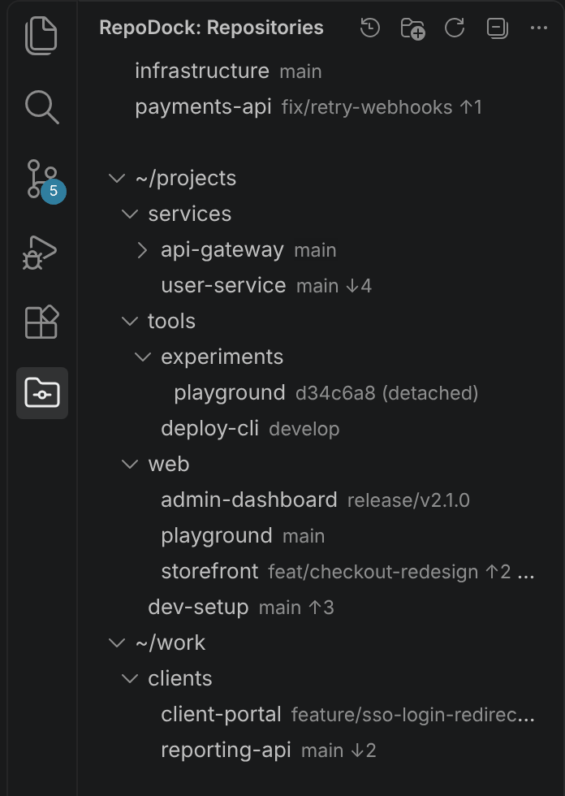
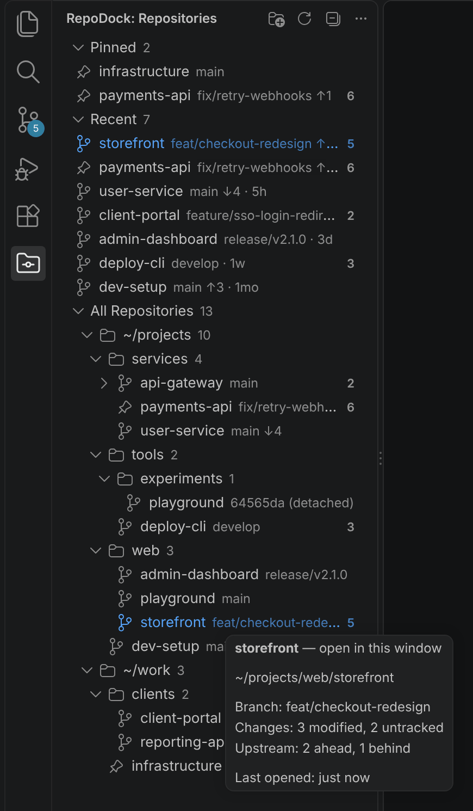
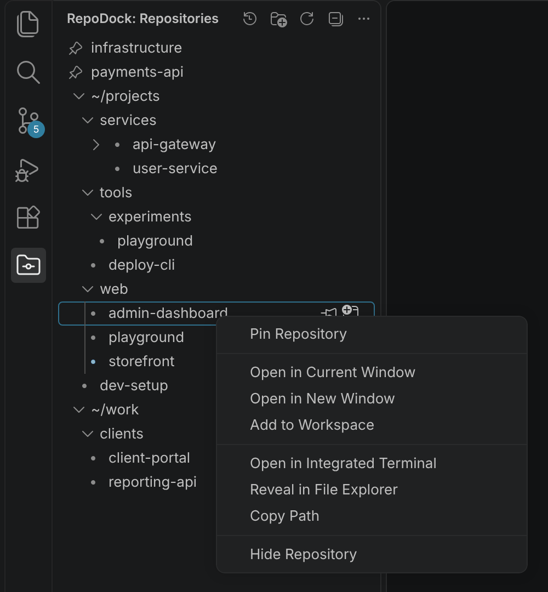
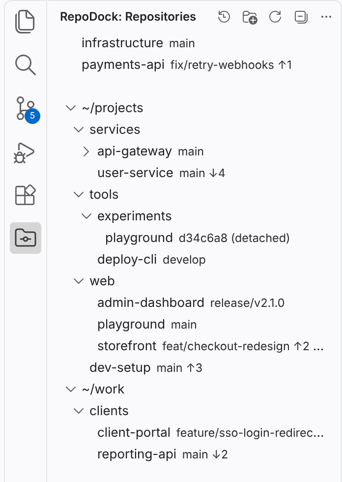

# RepoDock

Find every git repository inside the folders you add, and switch between them without leaving VS Code.

RepoDock scans the folders you choose and lists every repo it finds in a sidebar, with live git status. Clicking a row opens that repo.

## Contents

- [Features](#features)
- [Getting started](#getting-started)
  - [Install](#install)
- [Commands](#commands)
- [Settings](#settings)
- [Contributing](#contributing)
- [Support](#support)
- [License](#license)

## Features

- Finds every git repo in the folders you add, including repos inside other repos (submodules, vendored checkouts). Symlinked subfolders are not followed, so add the real folder rather than a link to it.
- Lists them in three sections of one tree in the Activity Bar:
  - **Pinned** holds the repos you pin, so the ones you use daily stay at the top.
  - **Recent** holds the repos you opened last, newest first, each with a compact `2h` timestamp.
  - **All Repositories** mirrors the disk: scanned folder, subfolders, then repos. A repo nested inside another repo sits under it. A repo under two overlapping folders appears once, in the more specific one.
- Shows the branch on every row, how far it is ahead of (↑) and behind (↓) its upstream, and a count of uncommitted files at the right edge. The tooltip adds the path and splits the count into modified and untracked.
- Reloads git status and rescans the folders when the window regains focus, so a repo you cloned in a terminal appears without a manual refresh.
- Highlights the repo that is open in the current window. It is always the first row of Recent.
- Folds any section or folder, and remembers what you folded when you switch to another repo.
- Leaves out a section that has nothing in it, so a new install shows only All Repositories.
- Tells same-named repos apart: Pinned and Recent add the folder (`web-app (work)`, `web-app (personal)`), and All Repositories shows each under its own folder.
- Hides the repos you never open.
- Filters as you type once the tree has focus.
- Makes no network requests, collects no telemetry, and ships no runtime dependencies. Paths and timestamps stay in VS Code's local storage.
- Reads git status without running anything a repository's own config names (hooks, filters, a file-system monitor), so a repo you unpacked but never opened cannot run code by being listed. [SECURITY.md](SECURITY.md) has the details.

Hover a row for its details, or right-click it for every action:

 

RepoDock uses the editor's own tree, icons, and colors, so it follows whichever theme you use:

Hover a row for its details, or right-click it for every action:

 

RepoDock uses the editor's own tree, icons, and colors, so it follows whichever theme you use:

## Getting started

RepoDock requires VS Code 1.96 or newer.

### Install

Every release ships to both registries at the same version. Install from whichever one your
editor reads.

| Editor                                  | Registry                                                                                                   | Command                                                |
| --------------------------------------- | ---------------------------------------------------------------------------------------------------------- | ------------------------------------------------------ |
| VS Code                                 | [Visual Studio Marketplace](https://marketplace.visualstudio.com/items?itemName=tylerdavidbailey.repodock) | `code --install-extension tylerdavidbailey.repodock`   |
| VSCodium and other non-Microsoft builds | [Open VSX](https://open-vsx.org/extension/tylerdavidbailey/repodock)                                       | `codium --install-extension tylerdavidbailey.repodock` |

To install without a registry, download the `.vsix` from any
[GitHub release](https://github.com/TylerDavidBailey/vscode-repodock/releases) and run
`code --install-extension repodock-<version>.vsix`.

### Add your folders

1. Open the RepoDock icon in the Activity Bar.
2. Click **Add Folder** and pick the directory, or directories, where your repos live.
3. Click any repo to open it. To narrow the list, focus the tree and type.

## Commands

| Command                                           | Description                                                               |
| ------------------------------------------------- | ------------------------------------------------------------------------- |
| `RepoDock: Add Folder`, `RepoDock: Remove Folder` | Add or remove one scan folder directly (Add Folder is a title-bar button) |
| `RepoDock: Refresh`                               | Rescan the folders and reload git state (title-bar button)                |
| `RepoDock: Manage Folders`                        | List scan folders, remove one, or add another (title-bar `…` menu)        |
| `RepoDock: Unhide All Repositories`               | Clear the hidden-repo list (title-bar `…` menu)                           |

The title bar also has the editor's own **Collapse All** button.

Hovering a repo row shows two buttons: **Pin Repository** or **Unpin Repository**, and **Open in New Window**. The context menu on a repo row has both of those plus **Open in Current Window**, **Add to Workspace**, **Open in Integrated Terminal**, **Copy Path**, and **Hide Repository**. It also has **Reveal in Finder** on macOS, and **Reveal in File Explorer** on Windows and Linux.

## Settings

| Setting                    | Default                                          | Description                                       |
| -------------------------- | ------------------------------------------------ | ------------------------------------------------- |
| `repodock.directories`     | `[]`                                             | Absolute folders to scan (`~` supported)          |
| `repodock.maxDepth`        | `4`                                              | Directory levels to descend below each folder     |
| `repodock.exclude`         | `["node_modules", "bower_components", ".Trash"]` | Directory names skipped while scanning            |
| `repodock.hiddenRepos`     | `[]`                                             | Repos hidden via the context menu (`~` supported) |
| `repodock.showNestedRepos` | `true`                                           | Show repos found inside another repo              |
| `repodock.recentCount`     | `10`                                             | How many repos the Recent section lists (1 to 50) |
| `repodock.openInNewWindow` | `false`                                          | Open repos in a new window when clicked           |

## Contributing

Read [CONTRIBUTING.md](CONTRIBUTING.md) for setup, tests, and the commit conventions that releases are generated from.

## Support

[Open an issue](https://github.com/TylerDavidBailey/vscode-repodock/issues) for bugs and feature requests. For a security problem, use the private process in [SECURITY.md](SECURITY.md) instead.

## License

[MIT](LICENSE)

The icons come from [Lucide](https://lucide.dev), used under the ISC License. [THIRD_PARTY_NOTICES.md](THIRD_PARTY_NOTICES.md) has the notice.
